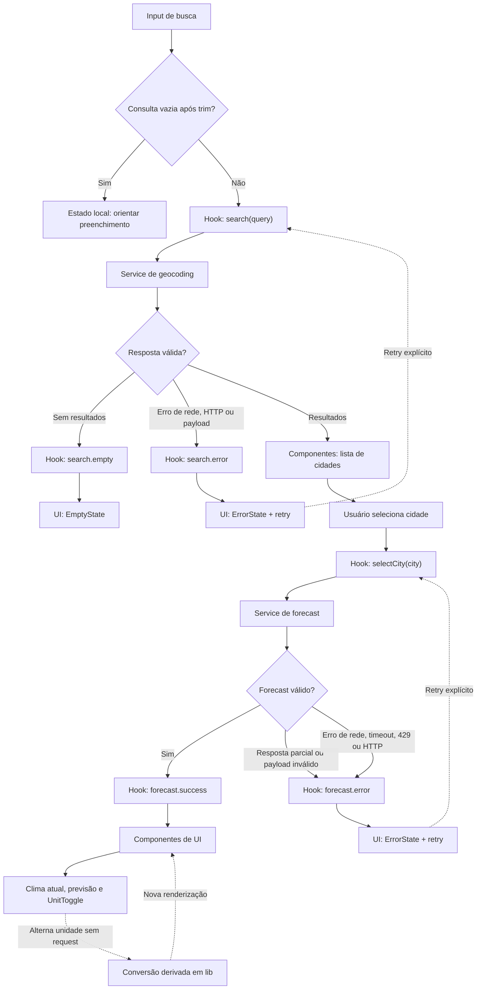

# Plano Técnico do Weather App

Fonte da verdade: `specs/weather-app-spec.md`.

Este plano define arquitetura, contratos e decisões de implementação. Não contém
código final. O objetivo é permitir a quebra em tarefas independentes sem criar
abstrações além das necessárias para o MVP.

## Architecture

A aplicação será uma SPA React executada pelo Vite, organizada em quatro
camadas, com dependências apontando para baixo:

1. **Presentation (`components/`):** componentes React recebem estado e
  callbacks, renderizam a interface e emitem eventos do usuário. Não conhecem
  URLs, `fetch` nem o formato bruto da Open-Meteo.
2. **Orchestration/state (`hooks/`):** o hook coordena busca, seleção, forecast,
  retry, concorrência e unidade, expondo o estado da experiência para a UI. Não
  contém markup nem regras de CSS.
3. **Data access (`services/`):** o service constrói requisições, executa
  `fetch`, aplica timeout, interpreta status HTTP e delega o parsing e a
  normalização para `lib/validation.ts`. Não conhece React ou componentes.
4. **Pure domain utilities (`lib/`):** funções sem efeitos colaterais para
  parsing, validação, normalização, conversão, mapeamento WMO e formatação. Não acessam
  rede, DOM ou estado global.

A direção permitida é `components -> hooks -> services -> lib`, com
`components` podendo usar funções de apresentação de `lib` quando necessário.
`lib` não depende das camadas superiores. `types/` contém contratos
compartilhados e pode ser importado pelas quatro camadas.

A UI não fará chamadas HTTP diretamente. O service não conhecerá componentes,
estado React ou strings visuais de erro. `lib/validation.ts` fará o parsing,
validação e normalização pura dos payloads; o service apenas executará a
requisição, verificará o status e delegará essa transformação. A tradução de
erros técnicos para mensagens em pt-BR fica na fronteira do hook ou em um
módulo de apresentação, não no service.

Essa separação cria pontos de teste independentes: funções de `lib` podem ser
testadas como unidades puras; `services` podem ser testados com `fetch` mockado;
`hooks` podem ser testados com services simulados; e `components` podem
verificar acessibilidade e interações sem depender da rede.

Decisões:

- Não usar Redux, Zustand, React Query ou outra biblioteca de estado no MVP.
- Não criar backend, proxy, autenticação ou persistência.
- Usar `AbortController` e um identificador de requisição para cancelar ou
  descartar respostas obsoletas.
- Manter os valores meteorológicos internos em Celsius e converter somente na
  apresentação.
- Usar `fetch` nativo e `URLSearchParams` para construir URLs.

## Tech Stack

- TypeScript 6 em modo `strict`, com `noUnusedLocals` e
  `noUnusedParameters`.
- React 19 e React DOM 19.
- Vite 8 como dev server e bundler.
- Tailwind CSS 3 para implementar o tema dark glassmorphism exigido pelo projeto.
- Vitest, Testing Library e `user-event` para testes unitários e de componente.
- Playwright para testes E2E.
- Biome para lint e formatação.
- `fetch`, `AbortController`, `Intl.DateTimeFormat` e APIs nativas do browser.
- Nenhuma dependência adicional é necessária para o MVP.

Comandos de verificação previstos: `pnpm lint`, `pnpm build`, `pnpm test` e
`pnpm test:e2e`.

## Project Structure

```text
src/
  App.tsx                         # composição da tela e do hook principal
  main.tsx                        # bootstrap React
  components/
    SearchBar.tsx                 # presentation: entrada e envio da busca
    CityResults.tsx               # presentation: lista e seleção de cidades
    CurrentWeather.tsx            # presentation: métricas atuais
    ForecastList.tsx              # presentation: cinco dias de previsão
    ForecastCard.tsx              # presentation: um dia da previsão
    UnitToggle.tsx                # presentation: Celsius/Fahrenheit
    Attribution.tsx               # presentation: crédito da Open-Meteo
    states/
      EmptyState.tsx              # presentation: ausência de dados
      ErrorState.tsx              # presentation: erro e ação recuperável
      LoadingState.tsx            # presentation: carregamento
  hooks/
    useWeather.ts                 # orchestration: fluxo da tela
  services/
    weatherService.ts             # data access: geocoding e forecast
  lib/
    format.ts                     # pure: datas, números e apresentação
    temperature.ts                # pure: conversão e arredondamento
    weatherCodes.ts               # pure: tabela WMO e fallback unknown
    validation.ts                 # pure: validação e normalização de payloads
  types/
    weather.ts                    # contratos compartilhados de domínio/API
  styles/
    index.css                     # tokens e estilos globais

docs/
  browser-compatibility.md        # registro manual da matriz de browsers

tests/
  unit/                            # funções, service e componentes
  e2e/                             # fluxos completos no browser
```

Um componente deve ter responsabilidade única. `App.tsx` apenas compõe a tela,
conecta o hook e encaminha handlers; regras de negócio permanecem no hook,
service ou funções puras.

### Responsabilidades e fronteiras

| Camada | Pode fazer | Não deve fazer | Teste principal |
| --- | --- | --- | --- |
| `components/` | Renderizar props, emitir eventos, expor semântica e acessibilidade. | Chamar API, validar payload bruto ou manter regras de retry. | Teste de componente e acessibilidade. |
| `hooks/` | Coordenar casos de uso, estados, request ids, abort e retry. | Renderizar JSX ou conhecer detalhes de URL. | Teste de hook com service mockado. |
| `services/` | Construir URLs, chamar API, timeout, status HTTP e delegar parsing/normalização. | Alterar estado React ou decidir layout/mensagem visual. | Teste unitário com `fetch` interceptado. |
| `lib/` | Transformar valores e validar dados de forma determinística. | Acessar rede, relógio global sem injeção ou DOM. | Teste unitário com entradas e saídas explícitas. |
| `types/` | Declarar contratos compartilhados. | Conter lógica ou efeitos colaterais. | Verificação pelo TypeScript. |

## Data Model

### Domain types

```ts
/** Unidade de temperatura escolhida para a apresentação. */
type Unit = 'celsius' | 'fahrenheit'

/** Localização retornada pelo geocoding e selecionada pelo usuário. */
interface City {
  /** Identificador Open-Meteo, quando fornecido. */
  id?: number
  /** Nome da cidade. */
  name: string
  /** Nome do país, quando fornecido. */
  country?: string
  /** Estado ou região derivado de `admin1`, quando fornecido. */
  region?: string
  /** Latitude em graus decimais, entre -90 e 90. */
  latitude: number
  /** Longitude em graus decimais, entre -180 e 180. */
  longitude: number
  /** Identificador IANA do fuso horário, quando fornecido. */
  timezone?: string
}

/** Condições atuais normalizadas a partir do objeto `current`. */
interface CurrentWeather {
  /** Horário da medição em ISO 8601, no fuso retornado pela API. */
  time: string
  /** Temperatura em Celsius; Fahrenheit é derivado na apresentação. */
  temperatureCelsius: number
  /** Código meteorológico WMO. */
  weatherCode: number
  /** Umidade relativa em percentual, quando disponível. */
  humidity?: number
  /** Velocidade do vento em km/h, quando disponível. */
  windSpeed?: number
  /** Pressão atmosférica em hPa, quando disponível. */
  pressure?: number
  /** Precipitação acumulada em mm, quando disponível. */
  precipitation?: number
}

/** Previsão diária normalizada a partir dos arrays `daily`. */
interface ForecastDay {
  /** Data local do dia no formato ISO 8601 (`YYYY-MM-DD`). */
  date: string
  /** Código meteorológico WMO do dia. */
  weatherCode: number
  /** Temperatura mínima em Celsius. */
  minimumCelsius: number
  /** Temperatura máxima em Celsius. */
  maximumCelsius: number
  /** Probabilidade máxima de precipitação em percentual, quando disponível. */
  precipitationProbability?: number
}

/** Conjunto de dados exibido para uma cidade selecionada. */
interface WeatherData {
  /** Cidade à qual os dados pertencem. */
  city: City
  /** Fuso horário usado para interpretar as datas, quando disponível. */
  timezone?: string
  /** Condições meteorológicas atuais. */
  current: CurrentWeather
  /** Exatamente cinco dias: hoje e os quatro dias seguintes. */
  days: ForecastDay[]
}

type WeatherOperationState = 'idle' | 'loading' | 'success' | 'empty' | 'error'
```

`City` exige `name`, latitude e longitude após a validação. `country`, `region`
e timezone são opcionais. Os cinco itens de `days` são obrigatórios. Campos
meteorológicos opcionais usam `undefined` no domínio e são convertidos para
“Não disponível” na apresentação.

Mapeamento dos campos da Open-Meteo para o domínio: `admin1` → `region`,
`current.temperature_2m` → `temperatureCelsius`,
`current.relative_humidity_2m` → `humidity`, `current.wind_speed_10m` →
`windSpeed`, `current.surface_pressure` → `pressure`, `current.weather_code` →
`weatherCode`, `daily.temperature_2m_min` → `minimumCelsius`,
`daily.temperature_2m_max` → `maximumCelsius` e
`daily.precipitation_probability_max` → `precipitationProbability`.

### API types

Os tipos de resposta externa devem permanecer separados dos tipos de domínio:

```ts
type GeocodingResponse = {
  results?: GeocodingResult[]
}

type GeocodingResult = {
  id?: number
  name?: unknown
  country?: unknown
  admin1?: unknown
  latitude?: unknown
  longitude?: unknown
  timezone?: unknown
}

type ForecastResponse = {
  timezone?: unknown
  current?: {
    time?: unknown
    temperature_2m?: unknown
    relative_humidity_2m?: unknown
    wind_speed_10m?: unknown
    surface_pressure?: unknown
    precipitation?: unknown
    weather_code?: unknown
  }
  daily?: {
    time?: unknown[]
    weather_code?: unknown[]
    temperature_2m_max?: unknown[]
    temperature_2m_min?: unknown[]
    precipitation_probability_max?: unknown[]
  }
}
```

Os campos externos são `unknown` de propósito: a validação deve provar a forma
antes de produzir `City` ou `WeatherData`. Não usar cast direto da resposta para
um tipo de domínio.

### Service contract

```ts
interface WeatherService {
  searchCities(query: string, signal?: AbortSignal): Promise<City[]>
  getForecast(city: City, signal?: AbortSignal): Promise<WeatherData>
}
```

`searchCities` recebe somente a consulta já aparada e retorna cidades
normalizadas. `getForecast` recebe a cidade selecionada, usa suas coordenadas e
retorna exatamente cinco dias. Ambos lançam apenas um erro técnico classificado;
componentes e hooks não dependem de `Response` ou do formato bruto da API.

O contrato técnico não carrega texto de apresentação:

```ts
type WeatherFailure = {
  kind: WeatherErrorKind
  retryAfterMs?: number
  recoverable: boolean
}
```

O service lança `WeatherFailure` (ou uma classe equivalente que o preserve), e
o hook converte `kind` em `WeatherError.message` em pt-BR antes de publicar o
estado. Assim, mensagens da UI não ficam acopladas ao acesso a dados.

### Application state

```ts
type WeatherErrorKind =
  | 'network'
  | 'timeout'
  | 'rate-limit'
  | 'invalid-payload'
  | 'incomplete-forecast'
  | 'http'

type WeatherError = {
  kind: WeatherErrorKind
  message: string
  retryAfterMs?: number
  recoverable: boolean
}

type WeatherState = {
  query: string
  unit: Unit
  search: {
    status: WeatherOperationState
    results: City[]
    error?: WeatherError
  }
  forecast: {
    status: Exclude<WeatherOperationState, 'empty'>
    selectedCity?: City
    data?: WeatherData
    error?: WeatherError
  }
  retry: {
    target: 'search' | 'forecast' | null
    available: boolean
    disabledUntil?: number
  }
  lastRequest:
    | { target: 'search'; query: string }
    | { target: 'forecast'; city: City }
    | null
}
```

O estado deve preservar a última `WeatherData` válida durante um novo loading ou
erro de forecast, conforme a spec. Um novo envio de busca limpa resultados
anteriores; uma resposta obsoleta nunca pode alterar o estado atual.

## Data Flow

1. O usuário digita no `SearchBar` e envia o formulário.
2. O hook faz `trim`; se o resultado estiver vazio, exibe validação local e não
   chama o service.
3. O hook incrementa o request id, cancela a busca anterior e muda a busca para
   `loading`.
4. `weatherService.searchCities` constrói a URL com `URLSearchParams`, chama o
   geocoding, trata HTTP e valida cada resultado.
5. Se não houver resultados válidos, o hook usa `empty`; caso contrário, usa
   `success` sem selecionar cidade automaticamente.
6. O usuário seleciona uma cidade. O hook salva a seleção e chama
   `weatherService.getForecast` usando exatamente latitude e longitude dela.
7. O service solicita cinco dias, delega o parsing e a normalização para
  `lib/validation.ts` e retorna o `WeatherData` produzido por essa função.
8. O hook atualiza `forecast.success`; a UI formata dados conforme `unit`.
9. A troca de unidade altera somente `unit`; não chama nenhum service.
10. Em erro recuperável, o hook preserva a última consulta válida e habilita
    retry. O retry repete somente a última operação associada, uma vez por
    acionamento.

Para concorrência, cada operação recebe um request id próprio. A resposta só
pode fazer commit se seu id ainda for o mais recente; `AbortController` é uma
otimização e não substitui essa verificação.

### Data flow diagram



## External APIs

### Geocoding

```text
GET https://geocoding-api.open-meteo.com/v1/search
  name={trimmedQuery}
  count=5
  language=pt
  format=json
```

A consulta é codificada por `URLSearchParams`. Os parâmetros relevantes são:

| Parâmetro | Valor do MVP | Finalidade |
| --- | --- | --- |
| `name` | consulta aparada | Nome informado pelo usuário. |
| `count` | `5` | Limita a resposta a cinco resultados. |
| `language` | `pt` | Prioriza dados textuais em português. |
| `format` | `json` | Define o formato da resposta. |

Exemplo resumido de resposta válida:

```json
{
  "results": [
    {
      "id": 3452925,
      "name": "Sao Paulo",
      "latitude": -23.5475,
      "longitude": -46.6361,
      "timezone": "America/Sao_Paulo",
      "country": "Brazil",
      "admin1": "Sao Paulo"
    }
  ]
}
```

Mapeamento para `City`:

- `id` → `City.id`;
- `name` → `City.name`;
- `country` → `City.country`;
- `admin1` → `City.region`;
- `latitude` → `City.latitude`;
- `longitude` → `City.longitude`;
- `timezone` → `City.timezone`.

`name`, `latitude` e `longitude` são obrigatórios após validação. A resposta
sem `results` ou com lista vazia vira `empty`; resultados inválidos são
descartados. A lista normalizada não pode exceder cinco itens.

`CityResults` expõe uma lista semanticamente navegável: o contêiner usa
`role="listbox"` e cada cidade usa `role="option"`, com nome acessível que
inclui cidade, região e país quando disponíveis. A seleção funciona por mouse,
teclado e foco visível.

### Forecast

```text
GET https://api.open-meteo.com/v1/forecast
  latitude={selectedLatitude}
  longitude={selectedLongitude}
  current=temperature_2m,relative_humidity_2m,wind_speed_10m,surface_pressure,precipitation,weather_code
  daily=weather_code,temperature_2m_max,temperature_2m_min,precipitation_probability_max
  forecast_days=5
  timezone=auto
```

A ordem dos parâmetros não é contrato; seus valores são. Os parâmetros
relevantes são:

| Parâmetro | Valor do MVP | Finalidade |
| --- | --- | --- |
| `latitude` | latitude da cidade selecionada | Define a localização do forecast. |
| `longitude` | longitude da cidade selecionada | Define a localização do forecast. |
| `current` | campos atuais definidos na spec | Solicita as métricas atuais. |
| `daily` | campos diários definidos na spec | Solicita a previsão diária. |
| `forecast_days` | `5` | Solicita hoje e os quatro dias seguintes. |
| `timezone` | `auto` | Retorna horários e datas no fuso da localização. |

Exemplo resumido de resposta válida:

```json
{
  "timezone": "America/Sao_Paulo",
  "current": {
    "time": "2026-09-30T14:00",
    "temperature_2m": 22.4,
    "relative_humidity_2m": 68,
    "wind_speed_10m": 12.6,
    "surface_pressure": 1012.4,
    "precipitation": 0.0,
    "weather_code": 2
  },
  "daily": {
    "time": ["2026-09-30", "2026-10-01", "2026-10-02", "2026-10-03", "2026-10-04"],
    "weather_code": [2, 61, 3, 80, 1],
    "temperature_2m_max": [27.1, 24.0, 25.3, 23.8, 28.0],
    "temperature_2m_min": [17.4, 16.8, 17.1, 15.9, 18.2],
    "precipitation_probability_max": [10, 70, 20, 60, 5]
  }
}
```

Mapeamento para `WeatherData`:

- `timezone` → `WeatherData.timezone`;
- cidade selecionada da requisição → `WeatherData.city`;
- `current.time` → `CurrentWeather.time`;
- `current.temperature_2m` → `CurrentWeather.temperatureCelsius`;
- `current.weather_code` → `CurrentWeather.weatherCode`;
- `current.relative_humidity_2m` → `CurrentWeather.humidity`;
- `current.wind_speed_10m` → `CurrentWeather.windSpeed`;
- `current.surface_pressure` → `CurrentWeather.pressure`;
- `current.precipitation` → `CurrentWeather.precipitation`;
- cada índice `i` de `daily.time` → `ForecastDay.date`;
- cada índice `i` de `daily.weather_code` → `ForecastDay.weatherCode`;
- cada índice `i` de `daily.temperature_2m_min` →
  `ForecastDay.minimumCelsius`;
- cada índice `i` de `daily.temperature_2m_max` →
  `ForecastDay.maximumCelsius`;
- cada índice `i` de `daily.precipitation_probability_max` →
  `ForecastDay.precipitationProbability`.

Os arrays diários devem ter exatamente cinco itens e os arrays presentes devem
ter o mesmo tamanho. Os campos `current.relative_humidity_2m`,
`current.wind_speed_10m`, `current.surface_pressure`, `current.precipitation`,
`daily.precipitation_probability_max` e `timezone` são opcionais. Campos
ausentes viram `undefined` no domínio e “Não disponível” na UI.

A requisição não deve enviar `temperature_unit`, `wind_speed_unit`,
`precipitation_unit` ou qualquer variante de `forecast_days`; o MVP usa apenas
as unidades padrão da API e `forecast_days=5`.

Respostas HTTP 200–299 seguem para JSON e validação; qualquer outro status vira
erro. HTTP 429 é classificado como `rate-limit` e respeita `Retry-After` quando
válido, sem retry automático. O parser aceita tanto segundos inteiros quanto
uma data HTTP; ambos são convertidos para milissegundos relativos ao relógio
injetável usado nos testes. Um valor ausente, negativo ou inválido não bloqueia
o retry: nesse caso, `retry.available` fica imediatamente disponível.

Cada chamada usa timeout de dez segundos. JSON inválido, números não finitos,
arrays diários com tamanho diferente de cinco ou arrays paralelos com tamanhos
diferentes são `invalid-payload` ou `incomplete-forecast`, conforme o caso.

A aplicação exibirá no rodapé, em todos os estados, o link acessível:
`Dados meteorológicos por Open-Meteo` apontando para
`https://open-meteo.com/`.

## State Management

`useWeather` será a única fronteira de estado da tela. Ele expõe:

```ts
type UseWeatherResult = {
  state: WeatherState
  search(query: string): Promise<void>
  selectCity(city: City): Promise<void>
  retry(): Promise<void>
  setUnit(unit: Unit): void
}
```

O hook não deve armazenar valores Fahrenheit derivados. `setUnit` apenas altera
o estado da unidade. A renderização usa funções puras para converter e
arredondar temperaturas. O estado inicial é `search.idle`, `forecast.idle` e
`unit: 'celsius'`, com `retry.target: null` e `retry.available: false`.

`retry.target` identifica se a última operação recuperável foi uma busca ou um
forecast. `lastRequest` armazena os argumentos exatos da operação que falhou:
a consulta já aparada ou a cidade selecionada. `retry()` só pode repetir essa
operação armazenada; depois do acionamento, `available` volta a `false` até a
nova operação falhar novamente.

Ações incompatíveis são bloqueadas na UI e também protegidas no hook: não há
seleção durante uma lista de resultados inválida, nem múltiplos retries para o
mesmo acionamento.

### Estados explícitos e transições

O estado vive somente em `useWeather`. A busca de cidades e o forecast têm
status independentes, porque uma lista de cidades pode estar em `success`
enquanto o forecast ainda está em `idle`.

| Operação | `idle` | `loading` | `success` | `empty` | `error` |
| --- | --- | --- | --- | --- | --- |
| Busca de cidades | Formulário inicial sem resultados. | Requisição em andamento; resultados anteriores são limpos. | Lista de até cinco `City`. | Nenhum resultado válido. | Falha técnica ou payload inválido; retry se recuperável. |
| Forecast | Nenhuma cidade selecionada. | Forecast em andamento; último `WeatherData` pode permanecer visível. | `WeatherData` válido com cinco dias. | Não aplicável; ausência de forecast é `idle` ou `error`. | Falha técnica ou resposta parcial; último dado válido permanece quando existir. |

Transições permitidas:

- `idle -> loading` ao enviar uma busca válida ou selecionar uma cidade;
- `loading -> success` quando a resposta válida chega;
- `loading -> empty` quando o geocoding não retorna resultados válidos;
- `loading -> error` em falha de rede, API, timeout ou validação;
- `error -> loading` somente por retry explícito após a janela de
  `Retry-After`, quando aplicável;
- `success -> loading` ao iniciar uma nova operação, sem apagar o último
  forecast válido durante o loading do forecast;
- respostas obsoletas não podem produzir nenhuma transição.

### Conversão derivada na renderização

O domínio armazena exclusivamente temperaturas em Celsius. Um helper puro de
apresentação recebe o valor Celsius e `Unit`:

```ts
function toDisplayTemperature(valueCelsius: number, unit: Unit): number {
  return unit === 'fahrenheit'
    ? (valueCelsius * 9) / 5 + 32
    : valueCelsius
}
```

O resultado é arredondado para o inteiro mais próximo somente no texto exibido.
`CurrentWeather.temperatureCelsius`, `ForecastDay.minimumCelsius` e
`ForecastDay.maximumCelsius` nunca são sobrescritos. `setUnit` atualiza apenas
`state.unit`, provoca nova renderização e não chama `search`, `selectCity` ou
qualquer service.

## Error Handling

O service converte falhas técnicas em `WeatherFailure`; o hook converte essa
falha em `WeatherError` com mensagem pt-BR antes de publicá-la. Componentes
recebem apenas mensagens seguras e estado acionável.

| Situação | Classificação | Comportamento |
| --- | --- | --- |
| Campo vazio ou espaços | validação local | Não chama a rede; orienta o preenchimento. |
| Falha de conexão, DNS ou CORS | `network` | Mensagem de conexão e retry quando houver consulta recuperável. |
| Timeout de 10 s | `timeout` | Aborta a chamada, informa demora excessiva e oferece retry. |
| HTTP 429 | `rate-limit` | Informa limite temporário; respeita `Retry-After` e não faz retry automático. |
| Outro HTTP não-2xx | `http` | Mensagem genérica de indisponibilidade e retry quando aplicável. |
| JSON inválido ou estrutura inválida | `invalid-payload` | Não renderiza métricas potencialmente incorretas. |
| Campo essencial ausente ou não numérico | `invalid-payload` | Descarta a resposta e informa que os dados não puderam ser carregados. |
| Menos de cinco dias ou arrays paralelos inconsistentes | `incomplete-forecast` | Não renderiza previsão parcial. |
| Código WMO desconhecido | sem falha de operação | Usa rótulo “Condição não disponível” e ícone `unknown`. |
| Campo opcional ausente | sem falha de operação | Renderiza “Não disponível” somente no campo afetado. |

O service é responsável por transformar exceções de `fetch`, timeout, status HTTP
e validação em `WeatherFailure`. O hook converte o tipo técnico em uma mensagem
pt-BR, decide se preserva dados anteriores, habilita retry e qual estado
publicar. Os componentes apenas exibem a mensagem segura e a ação disponível.

O console local pode receber a classificação técnica durante desenvolvimento,
mas nunca query, coordenadas ou dados pessoais. Não haverá logs persistentes,
analytics ou monitoramento no MVP.

## Testing Strategy

### Unit tests

Vitest cobre funções puras e services sem depender de rede real:

- trim e validação de busca;
- conversão Celsius/Fahrenheit, arredondamento e formatação numérica;
- cálculo de datas no timezone e fallback de timezone;
- tabela WMO, rótulos, ícones e fallback `unknown`;
- construção dos parâmetros e URLs de geocoding e forecast;
- validação e normalização de respostas de geocoding e forecast;
- limites de latitude/longitude e números finitos;
- arrays de cinco dias e arrays paralelos;
- classificação de status HTTP, HTTP 429, timeout, JSON inválido e payload
  inválido;
- preservação de `undefined` para campos opcionais ausentes.
- conversão de erros de `fetch` e timeout para as categorias do domínio.

O `fetch` deve ser mockado no teste do service. Cada teste deve verificar URL,
parâmetros, método, timeout, abort e mapeamento do JSON para o modelo, sem
acessar a Open-Meteo real.

### Component and hook tests

Vitest com Testing Library e `user-event` cobre componentes e hook isolados:

- `SearchBar`: submissão, trim, campo vazio e bloqueio durante loading;
- `CityResults`: lista, seleção manual, uma cidade e cidades homônimas;
- `CurrentWeather` e `ForecastCard`: valores, unidades, campos opcionais e
  código WMO desconhecido;
- `LoadingState`, `ErrorState` e `EmptyState`: cada estado renderiza seu próprio
  contrato semântico, e a composição de sucesso não quebra ao trocar de estado;
- `UnitToggle`: alternância sem nova chamada HTTP;
- estados `idle`, `loading`, `success`, `empty` e `error` do `useWeather`;
- envio vazio e envio com espaços;
- cidades homônimas e uso das coordenadas selecionadas;
- forecast atual e previsão de exatamente cinco dias;
- retry único, `Retry-After` e preservação do último resultado válido;
- descarte de resposta obsoleta;
- mensagens acessíveis, foco, teclado, atribuição e campos indisponíveis.

Os testes de componente devem mockar o hook ou o service conforme a fronteira
testada. Não repetir no componente testes de parsing já cobertos pelo service.
Componentes de apresentação recebem props e callbacks; somente `App` e o hook
devem conectar o fluxo completo.

### Accessibility and performance checks

- Testing Library deve localizar controles por roles e labels acessíveis e
  verificar foco após erro, loading e seleção.
- Playwright deve verificar navegação por teclado, foco visível, `aria-live` ou
  mecanismo equivalente para loading/erro, ausência de rolagem horizontal e
  nomes acessíveis, incluindo `listbox`/`option` nos resultados de cidade.
- A revisão manual deve verificar contraste WCAG 2.1 AA, foco visível em todos
  os controles, zoom de 200%, leitura dos estados por leitor de tela e
  operação completa sem mouse. Qualquer falha nesses itens bloqueia a entrega;
  o MVP não adiciona um analisador automático de contraste.
- O teste da troca de unidade deve medir somente a função pura com entradas
  determinísticas e confirmar que nenhum mock de service foi chamado. O limite
  de 100 ms é um gate de interação local, não uma chamada de rede.
- O teste E2E de desempenho deve interceptar uma resposta com latência
  controlada e registrar separadamente: envio da interação até o feedback de
  loading; recebimento da resposta até o primeiro resultado renderizado; e
  troca de unidade até a atualização visual. O primeiro resultado deve ocorrer
  em até 3 s após o recebimento da resposta, e a troca de unidade em até 100 ms.
  Um resultado em até 1 s é uma meta interna de desempenho, não um gate
  bloqueante. Nenhum teste deve depender da latência da Open-Meteo real.

### E2E and quality gates

Playwright valida somente comportamentos integrados no browser, com as chamadas
da Open-Meteo interceptadas pelo próprio Playwright. Cobrir:

- carregamento inicial, busca de cidade, lista de resultados e seleção manual;
- cidade inexistente e estado vazio;
- cidade homônima e forecast associado às coordenadas selecionadas;
- clima atual e exatamente cinco dias de previsão;
- alternância Celsius/Fahrenheit sem nova requisição interceptada;
- falha de rede, timeout, HTTP 429, retry e `Retry-After`;
- resposta obsoleta quando uma busca nova termina antes da anterior;
- navegação por teclado, foco visível, nomes acessíveis e anúncio dos estados;
- atribuição Open-Meteo presente em idle, sucesso e erro;
- viewport mobile de 320 px sem rolagem horizontal e com controles utilizáveis.

Os testes E2E não devem depender da Open-Meteo real. A matriz automatizada inclui
Chromium, Firefox e WebKit em viewport desktop e mobile de 320 px; WebKit cobre
o motor usado pelo Safari, e Chromium é também a referência técnica para Edge.
Essa matriz usa as versões instaladas pelo Playwright e funciona como smoke
coverage, não como substituta da compatibilidade exigida pela spec.

Antes da entrega, a compatibilidade deve ser verificada manualmente nos dois
últimos releases estáveis disponíveis de Chrome, Firefox, Safari e Edge. Cada
verificação deve registrar browser, versão, viewport e resultado em
`docs/browser-compatibility.md`; esse registro é obrigatório para liberar o
MVP.

`docs/browser-compatibility.md` será um registro versionado da compatibilidade
manual. Cada entrada deverá informar browser e versão exata, sistema
operacional ou dispositivo, viewport e orientação, data da verificação, fluxos
executados, resultado (`passed` ou `failed`) e observações ou referência para
eventual issue. Deve existir uma entrada para cada combinação das duas últimas
versões estáveis de Chrome, Firefox, Safari e Edge em desktop e mobile. O MVP
não será liberado enquanto houver combinação sem registro ou com resultado
`failed`.

Antes de concluir cada tarefa, executar o teste focado. Antes de entregar o
MVP, executar `pnpm lint`, `pnpm build`, `pnpm test` e `pnpm test:e2e`. A entrega
falha se houver erro de typecheck, lint, teste, rolagem horizontal em 320 px ou
falha de acessibilidade no fluxo principal.

## Risks & Trade-offs

- **API externa versus fixture local:** a Open-Meteo real representa melhor o
  contrato, mas torna testes lentos e instáveis. A escolha é mockar `fetch` e
  manter fixtures de respostas válidas e inválidas; testes manuais podem usar a
  API real durante desenvolvimento.
- **Vitest versus Playwright:** Vitest é mais rápido para lógica, services,
  hooks e componentes; Playwright é mais fiel para browser, layout e foco, mas
  é mais lento. A escolha é manter a maior parte da cobertura no Vitest e
  reservar E2E para fluxos críticos e viewport mobile.
- **Mock de service versus Mock Service Worker:** mockar o service simplifica
  testes unitários do hook e mockar `fetch` testa o contrato HTTP. Não usar MSW
  no MVP para evitar uma dependência adicional; Playwright intercepta as
  requisições E2E.
- **Request id e `AbortController`:** abortar reduz trabalho de rede, mas não
  garante sozinho que uma resposta já resolvida não faça commit. Usar ambos
  aumenta a robustez com complexidade pequena.
- **Estado local versus biblioteca de estado:** `useWeather` evita dependência
  e é suficiente para uma única tela; Redux, Zustand e React Query foram
  considerados desnecessários para o escopo atual.
- **Celsius interno versus unidades da API:** manter Celsius permite alternar
  a unidade sem novo request e centraliza arredondamento; solicitar Fahrenheit
  à API duplicaria estados e dificultaria a garantia de que a alternância não
  usa rede.
- **Validação manual versus schema library:** type guards manuais mantêm o
  bundle e as dependências pequenos; Zod ou biblioteca equivalente seria uma
  alternativa válida se o contrato crescer, mas não é necessária no MVP.
- **Sem logs persistentes:** reduz risco de privacidade e infraestrutura, mas
  limita diagnóstico. É aceitável porque o MVP não terá ambiente de produção;
  o console local basta para desenvolvimento.
